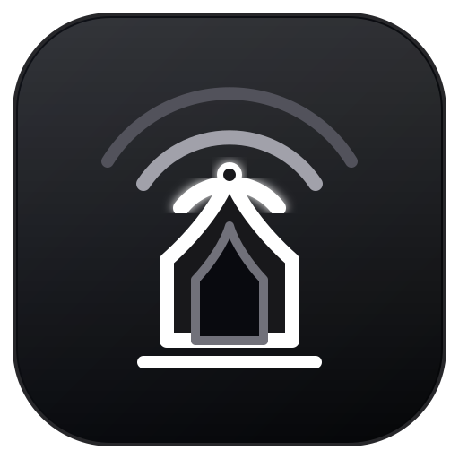
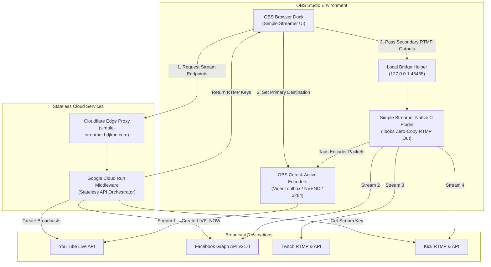

# Simple Streamer

<p align="center">
  
</p>

<p align="center">
  <strong>One-click multi-platform live streaming appliance embedded natively inside OBS Studio.</strong><br />
  Broadcast simultaneously to YouTube, Facebook Live, Twitch, and Kick with 0% extra CPU re-encoding overhead and zero web dashboard friction.
</p>

<p align="center">
  <a href="#features"></a>
  <a href="#system-compatibility"></a>
  <a href="#system-compatibility"></a>
  <a href="#package-managers"></a>
  <a href="LICENSE"></a>
</p>

---

## Overview

Most multi-streaming solutions require either:
1. **Expensive cloud restreaming services** ($15–$50/month) that introduce cloud proxy delay and cost.
2. **Heavy third-party multi-RTMP plugins** that re-encode video multiple times, overloading your CPU/GPU and dropping frames.
3. **Manual copy-pasting of stream keys** on every broadcast, especially Facebook Live whose temporary keys expire every 24 hours.

**Simple Streamer** solves this natively inside OBS Studio. It connects directly to platform APIs, injects dynamic keys on the fly, and uses a headless zero-copy native C plugin (`simple-streamer.plugin`) that directly splits the active encoder's packet stream across $N$ RTMP outputs with **zero duplicate encoding CPU**.

### 📊 Simple Streamer vs. Alternatives

| Feature | Simple Streamer | Traditional Multi-RTMP (`obs-multi-rtmp`) | Cloud SaaS (Restream.io / Castr) |
|---|---|---|---|
| **Annual Cost** | **Free / $5 Lifetime** | Free | $228 to $588 / year |
| **Extra CPU Usage** | **0% (Encoder Sharing)** | High (Runs $N$ separate encoders) | 0% (Relayed in cloud) |
| **Stream Key Setup** | **1-Click Automated Sync** | Manual copy-paste every stream | Automated API |
| **Broadcast Latency** | **Direct RTMP (0s delay)** | Direct RTMP (0s delay) | Added cloud delay (2–5s) |
| **Mobile Wi-Fi Remote** | **Included (Native Phone Control)** | ❌ None | ❌ Requires 3rd-party apps |
| **Data Privacy** | **100% Local-First / Open Source** | Local-First | Proprietary Cloud SaaS |

---

## Key Features

- **Universal 1-Click Go Live:** Enter title and description once; broadcast simultaneously to YouTube, Facebook Pages, Twitch, and Kick.
- **0% Duplicate Encoding CPU:** Replaces multi-encoder plugins with a native C plugin that taps OBS's active encoder bitstream directly.
- **Dynamic Facebook Key Inversion:** Automatically creates `LIVE_NOW` broadcasts via Meta Graph API v21.0 and sets up the RTMP endpoint dynamically.
- **Built-in 1-Click OAuth:** Connect channels directly from the OBS dock UI with zero token copying. Stream keys (including Kick via OAuth `streamkey:read`) are discovered automatically.
- **Live In-Dock Telemetry:** Real-time upload bitrate, output FPS, dropped frame percentage, and per-destination connection badges (`LIVE`, `STARTING`, `FAILED`).
- **Clean Remote Teardown:** Terminating stream in OBS automatically concludes the broadcast on remote platforms (ending Facebook Live and transitioning YouTube broadcasts cleanly).
- **Non-Destructive OBS Settings:** Automatically snapshots your personal OBS `Settings → Stream` configuration before broadcast kickoff and restores it upon stream termination so manual streaming setups are never lost.
- **Mobile Remote Control & Confidence Preview:** Control scenes (Stage & Cut), monitor master audio VU levels, and kickoff broadcasts from a smartphone via zero-IP mDNS (`http://simple-streamer.local:45455/remote`).
- **Stateless & Privacy-First:** Zero database. All OAuth tokens and stream destinations are stored strictly in client-side OBS `localStorage`.

---

## Architecture



---

## Project Structure

```text
simple-streamer/
├── backend/                  # Google Cloud Run stateless middleware (Node.js 20)
│   ├── src/                  # API routes (/orchestrate-live, /end-live, OAuth callbacks)
│   ├── Dockerfile            # Production container configuration
│   └── deploy-cloud-run.sh   # Automated GCP deployment script
├── dock/                     # OBS Studio custom browser dock (HTML, CSS, JS)
│   ├── index.html            # Main dark-themed operational control UI
│   ├── app.js                # Dock logic & state management
│   ├── obs-client.js         # Zero-dependency OBS WebSocket v5 client
│   └── style.css             # High-contrast accessible design
├── plugin/                   # Custom Native C plugin for OBS Studio
│   ├── src/simple-streamer.c # Native multi-RTMP output handler (0% extra CPU)
│   ├── build-mac.sh          # Native macOS universal compilation script
│   └── include/              # libobs headers & interfaces
├── installer/                # 1-Click native automated installers
│   ├── macos/                # macOS installer package (.pkg / .dmg builder)
│   └── windows/              # Windows Inno Setup installer script (.iss / .bat)
├── cloudflare-site/          # Cloudflare Worker edge proxy & legal pages
│   └── src/index.ts          # Edge proxy rules (/privacy, /terms, /data-deletion)
├── docs/                     # Comprehensive documentation suite
│   ├── PRODUCT_OVERVIEW.md   # Master product reference & feature tiers
│   ├── USER_GUIDE.md         # End-user and operator handbook
│   ├── architecture.md       # Technical spec & sequence diagrams
│   └── DEVELOPER_GUIDE.md    # Contributor & compilation guide
└── scripts/                  # CLI utilities & diagnostic test suites
```

---

## Quickstart

### 1. Download & Install

* **macOS:** Download `SimpleStreamer-Setup.dmg` from [Releases](https://github.com/midimahdi/simple-streamer/releases) and double-click `Install Simple Streamer.pkg`.
* **Windows:** Download and run `SimpleStreamer-Setup.exe`.

The installer automatically installs the native plugin, registers the background bridge helper, and configures the OBS browser dock.

### Package Managers

Fast 1-line installation via your system package manager:

**Windows (Winget):**
```powershell
winget install --exact --id MahdiDigital.SimpleStreamer
```

**macOS (Homebrew Cask):**
```bash
brew install --cask packaging/homebrew/simple-streamer.rb
```

---

## System Compatibility

- **OBS Studio:** Version 28.0.0 through 31.x+ (OBS WebSocket v5 enabled by default)
- **Windows:** Windows 10 & Windows 11 (64-bit)
- **macOS:** macOS 12 (Monterey), 13 (Ventura), 14 (Sonoma), 15 (Sequoia) — Universal Binary (Apple Silicon M1/M2/M3/M4 & Intel x86_64)

---

### 2. Connect Your Platforms

1. Open OBS Studio. The **Simple Streamer** dock will open automatically in your sidebar.
2. Click the **Settings `[⚙]`** button in the dock header.
3. Click **+ Add Platform** to connect your destinations:
   - **YouTube:** 1-Click Google OAuth.
   - **Facebook Live:** 1-Click Facebook OAuth (select any managed Page).
   - **Twitch:** 1-Click Twitch OAuth.
   - **Kick:** 1-Click Kick OAuth.

### 3. Go Live

1. Enter your stream **Title** and optional **Description**.
2. Toggle on the destinations you want to broadcast to using the target pills.
3. Click **▶ START BROADCAST**.

Simple Streamer orchestrates the remote broadcasts, starts your encoders, and brings all platforms live in seconds.

---

## Documentation Suite

* [Master Product Reference](docs/PRODUCT_OVERVIEW.md) — Comprehensive product capabilities, feature ranking, and roadmap.
* [User Guide](docs/USER_GUIDE.md) — Step-by-step operating instructions for streamers and volunteers.
* [Architecture Specification](docs/architecture.md) — Detailed 4-tier topology, zero-copy packet splitting, and API flows.
* [Developer & Build Guide](docs/DEVELOPER_GUIDE.md) — Compiling the C plugin, packaging installers, and cloud deployments.

---

## Security & Privacy

Simple Streamer is engineered around a **zero-knowledge, stateless architecture**:

- **No User Database:** The cloud backend never stores passwords, user accounts, stream keys, or tokens.
- **Local Credential Storage:** Tokens exist solely in your local OBS client-side storage and can be wiped instantly by clicking Disconnect or clearing local data.
- **GDPR & CCPA Compliant:** Full compliance documentation, terms of service, and user data deletion instructions are published at [simple-streamer.bdjlmn.com/data-deletion](https://simple-streamer.bdjlmn.com/data-deletion).

---

## Community & Bug Reports

- **Bug Reports:** If you encounter unexpected behavior, please submit a report using the [GitHub Bug Report Form](https://github.com/midimahdi/simple-streamer/issues/new?template=bug_report.yml). *Please include your OBS Log File URL via **Help → Log Files → Upload Current Log File**.*
- **Feature Requests:** Propose new platforms or automation features via the [Feature Request Form](https://github.com/midimahdi/simple-streamer/issues/new?template=feature_request.yml).
- **OBS Forums Resource:** See our official [OBS Studio Resource Listing Draft](docs/OBS_FORUMS_RESOURCE_LISTING.md) to join the community thread.

---

## License

Distributed under the **MIT License**. Created by [MAHDI DIGITAL LLC](https://bdjlmn.com).
