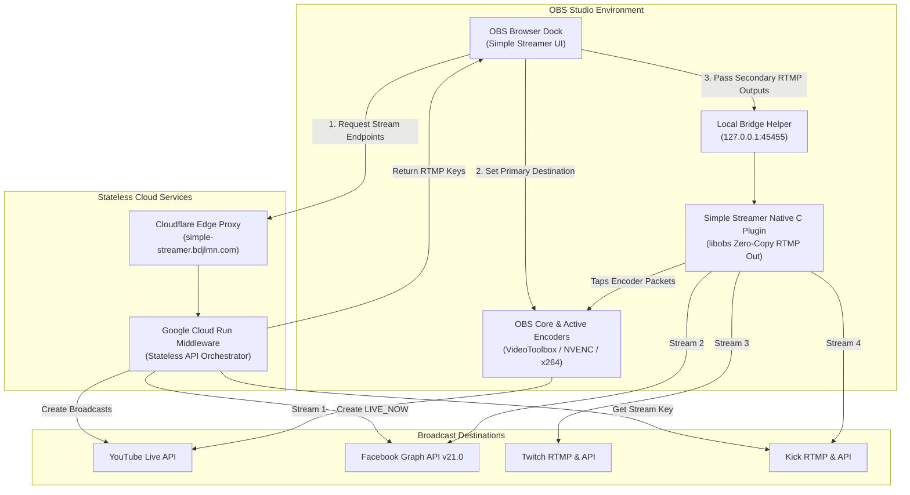

<div align="center">

# 📡 Simple Streamer

**Zero-CPU multi-platform live streaming appliance embedded natively inside OBS Studio.**  
*Broadcast simultaneously to YouTube, Facebook Live, Twitch & Kick with 1-click automated metadata sync, 0% duplicate encoder overhead, and phone remote control.*

[](https://github.com/midimahdi/simple-streamer/releases/latest)
[](https://github.com/midimahdi/simple-streamer/releases)
[](https://github.com/midimahdi/simple-streamer/releases/latest)
[](https://obsproject.com)
[](LICENSE)

<br/>

[**📥 Direct Downloads**](#downloads) &nbsp;•&nbsp; [**🎯 Why Simple Streamer**](#why) &nbsp;•&nbsp; [**📊 Comparison**](#comparison) &nbsp;•&nbsp; [**📱 Mobile Remote**](#mobile-remote) &nbsp;•&nbsp; [**🔬 Architecture**](#architecture) &nbsp;•&nbsp; [**🛠️ Developer Guide**](#developer-guide)

</div>

---

<a id="downloads"></a>
## ⚡ Direct Downloads (Latest Release: v1.1.0)

Choose your operating system to start downloading immediately:

### 🪟 Windows (10 & 11, 64-bit)
| Edition | Direct Download Link | Description |
| :--- | :--- | :--- |
| **64-bit Automated Installer** | [📥 **SimpleStreamer-Setup.exe**](https://github.com/midimahdi/simple-streamer/releases/latest/download/SimpleStreamer-Setup.exe) | 1-click installer: auto-registers the native C plugin, background helper, and OBS dock |
| **Winget Package Manager** | `winget install --exact --id MahdiDigital.SimpleStreamer` | 1-line installation via Windows Package Manager |

### 🍎 macOS (12 Monterey through 15 Sequoia)
| Chipset | Direct Download Link | Description |
| :--- | :--- | :--- |
| **Universal DMG (Apple Silicon & Intel)** | [📥 **SimpleStreamer-Setup.dmg**](https://github.com/midimahdi/simple-streamer/releases/latest/download/SimpleStreamer-Setup.dmg) | Drag-and-drop disk image containing the automated installer for M1–M4 & Intel Macs |
| **Homebrew Cask** | `brew install --cask packaging/homebrew/simple-streamer.rb` | 1-line installation via Homebrew Cask |

> [!TIP]
> **First-Launch Notes:**
> - **Windows:** Because Simple Streamer is an independent open-source tool without an enterprise EV certificate, Windows Defender SmartScreen may display *"Unrecognized app"*. Click **More info** $\rightarrow$ **Run anyway**.
> - **macOS:** If Gatekeeper prompts on initial launch, right-click `Install Simple Streamer.pkg` and choose **Open**, or run once in Terminal:  
>   `xattr -cr "/Library/Application Support/obs-studio/plugins/simple-streamer"`

---

<a id="why"></a>
## 🎯 Why Simple Streamer?

Most multi-streaming solutions require either:
1. **Expensive cloud restreaming services** (\$228 to \$588/year) that introduce cloud proxy latency (2–5s) and store your account credentials on third-party servers.
2. **Heavy third-party multi-RTMP plugins** that re-encode video multiple times, running separate hardware encoders that spike CPU/GPU by 20–30% and drop frames.
3. **Manual copy-pasting of stream keys** on every broadcast, especially Facebook Live whose temporary keys expire every 24 hours.

**Simple Streamer** solves this natively inside OBS Studio. It taps directly into the active hardware encoder's bitstream (NVENC, Apple VideoToolbox, QuickSync, or x264) and fans out the encoded packets across all destinations with **0% duplicate encoding CPU**.

```
OBS Video Engine ────► 1 Hardware Encoder ────► Zero-Copy Packet Split ────► YouTube + Twitch + Kick + Facebook
```

| Core Feature | What It Does | Why It Matters |
| :--- | :--- | :--- |
| **⚡ 0% Duplicate Encoder CPU** | Multiplexes packets from OBS's active hardware encoder | Stream to 4+ platforms simultaneously without needing a dual-PC setup or dropping a single frame. |
| **🚀 Universal 1-Click Broadcast** | Auto-creates YouTube & Facebook broadcasts via official APIs | Type title & description once. Simple Streamer schedules broadcasts and injects fresh keys automatically. |
| **📱 Mobile Phone Remote Control** | Web remote accessible via local Wi-Fi or cellular cloud | Trigger scenes, monitor confidence preview, adjust master audio, and start/stop streams from your phone. |
| **📝 Mid-Stream Metadata Updates** | Updates live titles and descriptions while streaming | Correct typos or update stream details across all platforms simultaneously without stopping OBS. |
| **🔄 Safe OBS Profile Restore** | Automatically snapshots OBS stream settings before live | Restores your previous personal settings on teardown so manual streaming setups are never broken. |
| **📊 Real-Time Dock Telemetry** | Monitored bitrate, FPS, dropped frame % and health badges | Full stream health visibility directly inside your OBS sidebar—no secondary browser dashboards. |
| **🔒 Zero-Knowledge & Local-First** | Tokens and configuration stay strictly in client-side storage | Zero cloud database. Your video never transits our servers, and credentials stay on your PC. |

---

<a id="comparison"></a>
## 📊 Simple Streamer vs. Alternatives

| Capability | Simple Streamer | Traditional Multi-RTMP (`obs-multi-rtmp`) | Cloud SaaS (Restream.io / Castr) |
| :--- | :--- | :--- | :--- |
| **Annual Cost** | **Free / \$5 Lifetime** | Free | \$228 to \$588 / year |
| **Extra CPU Usage** | **0% (Encoder Sharing)** | High (Runs separate encoders) | 0% (Relayed in cloud) |
| **Stream Key Setup** | **1-Click Automated Sync** | Manual copy-paste every stream | Automated API |
| **Broadcast Latency** | **Direct RTMP (0s delay)** | Direct RTMP (0s delay) | Added cloud delay (2–5s) |
| **Mobile Remote Control** | **Included (Wi-Fi + Cellular)** | ❌ None | ❌ Requires 3rd-party apps |
| **Mid-Stream Title Updates** | **1-Click Unified Update** | ❌ None | Web dashboard only |
| **Data Privacy** | **100% Local-First / Open Source** | Local-First | Proprietary Cloud SaaS |

---

<a id="mobile-remote"></a>
## 📱 Mobile Remote Control & Confidence Monitoring

Simple Streamer includes a built-in mobile control interface. Scan the QR code displayed in the OBS dock to control your broadcast from any smartphone:

- **Scene Switching:** Studio Mode controls (Stage & Cut) with responsive touch buttons.
- **Audio Monitoring:** Real-time master microphone VU meter and 1-tap mute toggle.
- **Stream Info:** View live broadcast timer, active output platforms, and stream health.
- **Dual Connectivity:** Works over zero-configuration local Wi-Fi (`mDNS`) or encrypted cellular cloud relay (WebRTC / TURN).

---

<a id="architecture"></a>
<details>
<summary><b>🔬 Technical Architecture & Safety Mechanisms</b></summary>

### Zero-Copy Encoder Multiplexing
Simple Streamer uses a lightweight headless native C plugin (`simple-streamer.plugin`) written against `libobs`.
Instead of creating independent encoder instances (which re-encode the frame), it intercepts the primary streaming output:
1. Obtains the active video and audio encoders from `obs_frontend_get_streaming_output()`.
2. Attaches secondary RTMP outputs (`obs_output_t`) directly to the running encoders via `obs_output_set_video_encoder()` and `obs_output_set_audio_encoder()`.
3. When the encoder produces an NAL packet, `libobs` broadcasts the packet to all attached outputs simultaneously.

### Stream Lifecycle & Isolation
- **Managed Broadcasts:** When started from Simple Streamer, all selected platforms are orchestrated and monitored with live telemetry.
- **External Stream Safety:** If you start a broadcast natively via OBS or another plugin, Simple Streamer automatically recognizes it as an external stream (`● OBS STREAMING (EXTERNAL)`), leaving your manual workflow undisturbed.

### Topology Overview



### Project Directory Structure
```text
simple-streamer/
├── dock/                     # OBS Studio custom browser dock (HTML, CSS, JS)
├── plugin/                   # Custom Native C plugin for OBS Studio (libobs zero-copy)
├── backend/                  # Google Cloud Run stateless middleware (Node.js 20)
├── cloudflare-site/          # Cloudflare Worker edge proxy & landing page
├── installer/                # Automated installer scripts (Windows Inno Setup & macOS PKG)
├── packaging/                # Package manager manifests (Winget & Homebrew Cask)
└── scripts/                  # Diagnostic test suites & orchestrator verification
```
</details>

---

<a id="developer-guide"></a>
<details>
<summary><b>🛠️ Developer Guide: Building from Source</b></summary>

### Prerequisites
- CMake 3.20+
- OBS Studio 28.0+ headers / development libraries
- Node.js 20+ (for dock and backend tests)
- Xcode (macOS) or Visual Studio 2022 (Windows)

### Building the Native Plugin (macOS)
```bash
cd plugin
bash build-mac.sh
```
This produces the universal binary (`simple-streamer.plugin`) for both Apple Silicon (`arm64`) and Intel (`x86_64`) and copies it into your OBS plugins directory.

### Running Backend Verification Suite
```bash
cd backend
npm test
```
Runs the full 9/9 automated orchestrator test suite covering OAuth gatekeeping, anti-spam rate limiting, cloud preset conflict resolution, and Stripe verification.
</details>

---

## 💬 Community & Bug Reports

- **Bug Reports:** Encountered an issue? Submit a report via the [GitHub Bug Report Form](https://github.com/midimahdi/simple-streamer/issues/new?template=bug_report.yml). *Please include your OBS Log URL via **Help → Log Files → Upload Current Log File**.*
- **Feature Requests:** Propose new platforms or automation features via the [Feature Request Form](https://github.com/midimahdi/simple-streamer/issues/new?template=feature_request.yml).
- **OBS Forums Resource:** Join our official [OBS Studio Resource Listing Thread](docs/OBS_FORUMS_RESOURCE_LISTING.md).

---

## 📜 License

Distributed under the **MIT License**. Copyright (c) 2026 **Mahdi (MAHDI DIGITAL LLC)**. See [LICENSE](LICENSE) for details.
