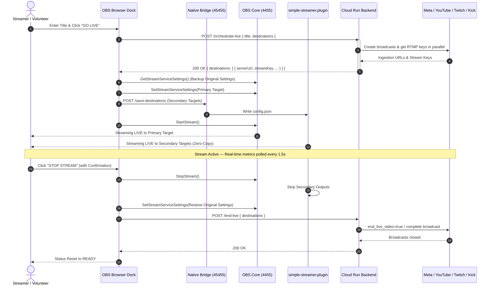

# Simple Streamer — Technical Architecture & Engineering Spec

**Simple Streamer** is an open-source, stateless, multi-destination live broadcasting appliance embedded directly inside OBS Studio. It automates simultaneous ingestion across **YouTube**, **Facebook Live**, **Twitch**, and **Kick** using native encoder-sharing with 0% duplicate encoding CPU overhead.

---

## 1. System Topology

```
+-----------------------------------------------------------------------------------------+
|                                    LOCAL STREAMER MACHINE                               |
|                                                                                         |
|  +---------------------------+       Native OBS WS v5       +------------------------+  |
|  |    OBS Browser Dock       |<============================>|       OBS Studio       |  |
|  | (Vanilla HTML/CSS/JS UI)  |        (Port 4455)           |      (OBS 28.0+)       |  |
|  +---------------------------+                              +------------------------+  |
|         |           |                                            |              |       |
|         | HTTP      | HTTP                                       | Primary RTMP | Video |
|         | (Bridge)  | (Cloud)                                    | Output       | Audio |
|         v           |                                            v              v       |
|  +---------------+  |                              +---------------------------------+  |
|  | Native Bridge |  |                              |    simple-streamer.plugin       |  |
|  | Daemon (C/ObjC|  |                              |    (Native C libobs Plugin)     |  |
|  |  Port 45455)  |  |                              |    - Zero Re-encoding           |  |
|  +---------------+  |                              |    - Dynamic RTMP Outputs 1..N  |  |
|         |           |                              +---------------------------------+  |
|         +-----------+--------------------------------------------|              |       |
|                     |                                            | RTMP 2       | RTMP N|
+---------------------|--------------------------------------------|--------------|-------+
                      |                                            |              |
                      | HTTPS (Zero-Cache Proxy)                   |              |
                      v                                            |              |
+--------------------------------------------------------+         |              |
|              CLOUDFLARE WORKER PROXY                   |         |              |
|           (simple-streamer.bdjlmn.com)                 |         |              |
+--------------------------------------------------------+         |              |
                      |                                            |              |
                      | Upstream Reverse Proxy                     |              |
                      v                                            |              |
+--------------------------------------------------------+         |              |
|        GCP CLOUD RUN BACKEND (Node.js 20 ES)           |         |              |
|             (simple-streamer-513609)                   |         |              |
|                                                        |         |              |
|  - Meta Graph API v21.0 Engine (LIVE_NOW, probe, end)  |         |              |
|  - YouTube Data API v3 Engine (insert, bind, status)   |         |              |
|  - Twitch Helix OAuth2 PKCE Engine                     |         |              |
|  - Kick API OAuth2 PKCE Engine (streamkey:read)        |         |              |
+--------------------------------------------------------+         |              |
     |                |                |               |           |              |
     | REST           | Graph API      | REST          | REST      |              |
     v                v                v               v           |              |
+----------+    +------------+   +------------+   +----------+     |              |
| YouTube  |    | Meta/FB    |   |   Twitch   |   |   Kick   |     |              |
| Data API |    | Graph API  |   | Helix API  |   | Public API     |              |
+----------+    +------------+   +------------+   +----------+     |              |
     ^                ^                ^               ^           |              |
     | Ingestion      | Ingestion      | Ingestion     | Ingestion |              |
     +----------------+----------------+---------------+-----------+--------------+
```

---

## 2. The 4-Tier Architecture

### Tier 1: Embedded Browser Dock (`dock/`)
* **Technology:** Vanilla JavaScript (ES2022), CSS3 custom properties, HTML5. Zero external NPM dependencies or UI frameworks.
* **Environment:** Chromium Embedded Framework (CEF) inside OBS Studio.
* **State Management:** Fully client-side using `localStorage`. Simple Streamer does **not** maintain a cloud database of streamer accounts, tokens, or personal data.
* **OBS Communication:** Native OBS WebSocket v5 protocol (`obs-client.js`). Directly controls:
  - Stream state (`GetStreamStatus`, `StartStream`, `StopStream`).
  - Primary service settings (`SetStreamServiceSettings`).
  - Real-time encoder metrics (`GetStats`, `GetOutputStatus`).

### Tier 2: Local Native Layer
#### A. Native Multi-Output Plugin (`plugin/simple-streamer.c`)
* **Technology:** Compiled C shared library linked against `libobs` (`obs.h`, `obs-module.h`).
* **Zero-Copy Architecture:**
  - Standard multi-streaming plugins often re-encode video frames through extra software encoders, consuming massive CPU/GPU resources.
  - `simple-streamer.plugin` hooks directly into the **already encoded** video and audio packets of the active OBS stream output using `obs_output_create("rtmp_output", ...)`.
  - It replicates the encoded bitstream across $N$ secondary RTMP endpoints simultaneously with **0% duplicate encoder overhead**.
* **Dynamic Mid-Stream Synchronization & Individual Retries:**
  - The plugin runs a tick accumulator (`obs_add_tick_callback`) checking every 0.5s for updates written to `config.json`.
  - If a destination was offline or dropped and the streamer clicks `↻ Retry` in the dock, the updated target is automatically started mid-stream without interrupting OBS Core's primary stream or other active destinations.
* **Configuration:** Reads its target outputs from `~/Library/Application Support/obs-studio/plugin_config/simple-streamer/config.json` (or Windows `%APPDATA%\obs-studio\...`). Accepts both boolean `true` and integer `1` flags for target enablement.

#### B. Native Bridge Daemon (`installer/macos/simple-streamer-bridge.m`)
* **Technology:** Lightweight Objective-C daemon listening on `127.0.0.1:45455`. Managed via macOS `launchd` (`com.bdjlmn.simple-streamer`).
* **Responsibilities:**
  - `/open?url=...`: Opens platform OAuth authorization windows in the user's default desktop browser rather than inside CEF.
  - `/focus-obs`: Programmatically raises and focuses OBS Studio window when OAuth flow finishes in the browser.
  - `/save-destinations`: Atomic file writer for the C plugin's `config.json`.
  - `/obs-config`: Detects OBS port and WebSocket passwords automatically from `obs-websocket/config.json`.

### Tier 3: Edge Routing & Proxy Layer (`cloudflare-site/`)
* **Technology:** Cloudflare Worker deployed to `simple-streamer.bdjlmn.com`.
* **Caching Policy:**
  - Enforces strict `Cache-Control: no-store, no-cache, must-revalidate, max-age=0` on all `/api/*`, `/auth/*`, `/broadcast-status`, `/end-live`, and `/orchestrate-live` endpoints.
  - Completely prevents Cloudflare edge and Chromium CEF from caching dynamic OAuth session polls.
* **Public Pages:** Serves static, accessible HTML for Privacy Policy (`/privacy`), Terms of Service (`/terms`), and Product Overview (`/`).

### Tier 4: Serverless Orchestrator Backend (`backend/`)
* **Technology:** Stateless Node.js 20 ES module running on Google Cloud Run (`simple-streamer-513609`).
* **Platform APIs:**
  - **Meta Graph API v21.0:** Queries `/me/accounts`, `/me/businesses`, probes pages via `UNPUBLISHED` live broadcast tests, mints dynamic `LIVE_NOW` broadcast ingestion keys, and triggers instant termination via `end_live_video=true`.
  - **YouTube Data API v3:** Exchanges Google OAuth authorization codes for long-lived offline refresh tokens, automatically creates `liveBroadcasts`, binds `liveStreams`, and monitors broadcast lifecycle.
  - **Twitch Helix API:** Handles OAuth 2.0 PKCE, queries channel profile and stream keys, and updates channel stream titles via `PATCH /helix/channels`.
  - **Kick Public API:** Handles OAuth 2.0 PKCE, queries channel stream credentials using `streamkey:read` scope, and updates stream categories/titles.

---

## 3. Dynamic Key Routing Mechanics

### The Ingestion Challenge
* **YouTube, Twitch, Kick:** Typically ingest using permanent or semi-permanent RTMP keys.
* **Facebook Live:** Generates a **unique, one-time dynamic stream key** for every single live broadcast session (`status=LIVE_NOW`).
* **OBS Stream Settings:** Historically, OBS only supported a single RTMP target in `Settings → Stream`.

### The Solution: Primary / Secondary Inversion & Dual-Mode Routing
```
[GO LIVE TRIGGERED]
        │
        ├──> Identify Connection Modes:
        │    ├─ OAuth Targets: Minted dynamically via Cloud Run /orchestrate-live
        │    └─ Stream Key & Custom RTMP Targets: Pre-configured static endpoints
        │
        ├──> Destination 0 (Primary Target):
        │    Injected into OBS Core via OBS WebSocket SetStreamServiceSettings:
        │    { server: dest0.serverUrl, key: dest0.streamKey }
        │
        ├──> Destinations 1..N (Secondary Targets):
        │    Injected into Native C Plugin via Local Bridge (127.0.0.1:45455):
        │    Written to plugin config.json
        │
        └──> OBS StartStream Executed:
             - OBS Core sends Primary stream.
             - Native C plugin detects stream start and mirrors encoded packets
               to Destinations 1..N simultaneously (Zero extra encoding CPU).
```

### Destination Data Model
```typescript
interface StreamDestination {
  id: string;
  platform: 'youtube' | 'facebook' | 'twitch' | 'kick' | 'instagram' | 'custom';
  name: string;
  connectionMode: 'oauth' | 'stream_key' | 'custom_rtmp';
  enabled: boolean;
  serverUrl: string;
  streamKey: string;
  credentials?: {
    accessToken?: string;
    refreshToken?: string;
    userToken?: string;
    pageId?: string;
  };
  metadataSyncSupported: boolean; // true for OAuth, false for stream_key/custom
}
```

---

## 4. Lifecycle Sequence Diagram



---

## 5. Security & Privacy Guarantees

1. **Zero Database / Zero PII Storage:**
   The backend orchestrator is purely stateless. No user accounts, credentials, stream keys, or logs are written to any database.
2. **Client-Side Secret Isolation:**
   All OAuth tokens (`refresh_token`, Page access tokens) are stored exclusively in the streamer's local OBS CEF `localStorage`.
3. **Local Bridge Security:**
   The native bridge binds strictly to loopback IPv4 (`127.0.0.1:45455`) and rejects external network requests.
4. **Instant Ingestion Teardown:**
   Every Facebook broadcast is explicitly ended with `end_live_video=true` upon disconnect, preventing unauthorized RTMP re-use.

---

## 6. Client-Side Asset Processing & Thumbnail Pipeline

To maintain broadcast quality across platforms while protecting uplink bandwidth during stream initiation, custom thumbnails undergo client-side normalization before leaving the operator's machine.

```
[Raw User Image: 5MB-25MB PNG/JPG]
                │
                v
  [OBS Browser Dock (Chromium CEF)]
  ├── HTML5 OffscreenCanvas Scaling
  │   ├── Force 16:9 Aspect Ratio (1280 × 720 px)
  │   └── Center-crop or blurred letterbox padding
  ├── JPEG Compression Engine (82% quality, progressive)
  └── Memory Output: Binary Blob (< 250 KB in ~100ms)
                │
                v
     [Cloud Run Backend Proxy]
                │
      ┌─────────┴─────────┐
      │                   │
      v                   v
[YouTube Data API]  [Facebook Graph API]   [Twitch & Kick]
(thumbnails.set)    (/{video_id}/thumbnails)  (Bypassed: Native
                                              video frame capture)
```

### Technical Guarantees
1. **Zero Uplink Choke:** Compressing locally ensures stream startup packets are never delayed by a heavy 15MB graphic upload sharing the same internet connection.
2. **Stateless Transmission:** Thumbnails pass through the Cloud Run backend ephemerally in-memory (base64 or multipart stream); no assets are written to cloud storage buckets or server disks.
3. **Non-Fatal Resilience:** If YouTube returns `403 thumbnailNotPermitted` (due to unverified phone status on the user's channel), the error is caught safely. The live broadcast continues uninterrupted, and an informational warning is logged.
